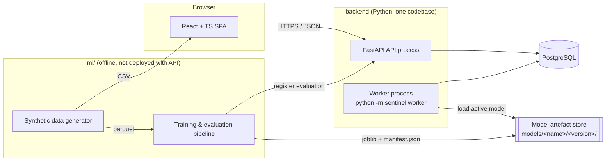
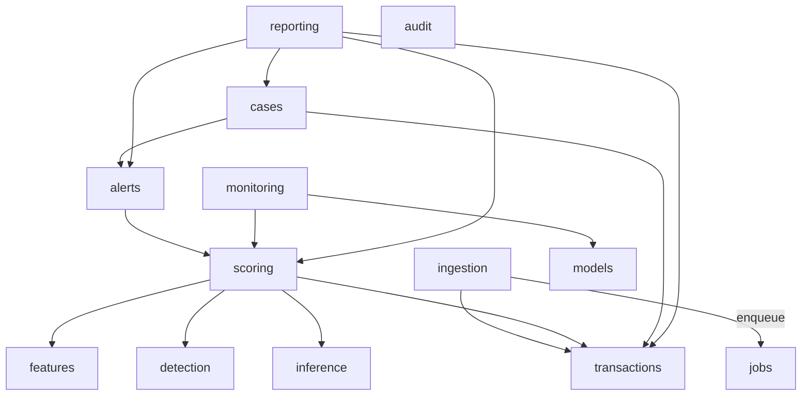
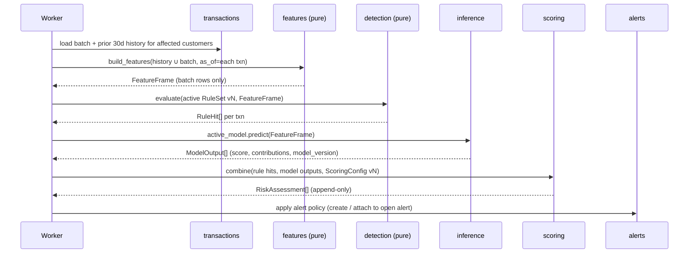

# Sentinel — Architecture

> Phase 1 design. Versions are pinned in Phase 2 after checking current stable releases.

## 1. Shape of the system

A **modular monolith**: one FastAPI codebase, one PostgreSQL database, and two process types started from that codebase — the API server and a background worker. ML experimentation lives in a separate package that produces versioned model artefacts; the application only *loads* those artefacts.



### Why a monolith
The domain modules are tightly coupled through one transactional database (an assessment, an alert and its audit record must commit together). Splitting them into services would add network failure modes, distributed transactions and deployment overhead with no scaling benefit at this volume. Module boundaries are enforced in code instead (see §3), so a module could be extracted later if a real need appeared.

### Why a worker process and a DB-backed job queue (no Redis/Celery)
Scoring a 50k-row import takes longer than an HTTP request should. A `processing_jobs` table plus a worker that claims jobs with `SELECT … FOR UPDATE SKIP LOCKED` gives durable, retryable background work using infrastructure we already run. FastAPI `BackgroundTasks` was rejected because jobs would be lost on restart. Celery + Redis was rejected as unjustified extra infrastructure for a single-node simulation.

## 2. Repository layout

```
sentinel/
├── backend/
│   ├── src/sentinel/
│   │   ├── main.py               # FastAPI app factory
│   │   ├── worker.py             # job loop entry point
│   │   ├── core/                 # config, db session, security, logging, errors, pagination
│   │   ├── features/             # PURE feature engineering (pandas) — shared with ml/
│   │   ├── detection/            # PURE rule engine — no DB, no FastAPI
│   │   ├── inference/            # model interface, registry loader, explainers
│   │   └── modules/
│   │       ├── auth/             # users, roles, tokens
│   │       ├── ingestion/        # imports, validation, rejected rows
│   │       ├── transactions/     # read models, search, customer history
│   │       ├── rules/            # rule config CRUD (wraps detection/)
│   │       ├── scoring/          # combine rules + model → assessment
│   │       ├── alerts/
│   │       ├── cases/
│   │       ├── models/           # registry, evaluations, activation
│   │       ├── monitoring/       # drift, volumes, score distributions
│   │       ├── reporting/        # dashboard aggregates
│   │       └── audit/
│   ├── alembic/
│   └── tests/ (unit/, integration/)
├── ml/
│   ├── sentinel_ml/
│   │   ├── generate/             # synthetic data generator (seeded)
│   │   ├── datasets/             # splitting, versioning, dataset cards
│   │   ├── train/                # pipelines per model family
│   │   └── evaluate/             # metrics, plots, reports
│   ├── notebooks/                # exploration only; nothing imported from here
│   └── tests/
├── frontend/                     # React + TS + Vite
├── models/                       # trained artefacts (git-ignored except a small demo model)
├── data/                         # generated datasets (git-ignored); seed CSVs generated on demand
├── docs/
├── docker-compose.yml
└── .github/workflows/
```

Each `modules/<name>/` contains `models.py` (SQLAlchemy), `schemas.py` (Pydantic), `repository.py` (queries), `service.py` (business logic, transactions, audit), `router.py` (HTTP only), `permissions.py`.

## 3. Module boundaries and dependency rules



Rules (checked in CI with `import-linter`):
1. `features/`, `detection/` and `inference/` are **pure**: no imports from `modules/`, FastAPI or SQLAlchemy. They take DataFrames/dataclasses in and return dataclasses out. This is what makes them testable and reusable by `ml/`.
2. Routers call only their own module's service. Services may call *other modules' services*, never other modules' repositories.
3. Every write service method takes the acting user and writes its audit record in the same DB transaction.
4. `ml/` may import `sentinel.features` (to guarantee identical feature code at train and serve time). `backend/` never imports `ml/`.

## 4. The scoring pipeline



### Train/serve parity
`sentinel.features.build_features()` is the single implementation used by both training (over the full historical dataset) and inference (over history + new batch). Every window aggregate is computed **strictly before** the transaction being scored (`closed="left"`), so the same function cannot leak future information in either context. A parity test computes features for a sample offline and through the worker path and asserts equality.

### Model inference interface

```python
class FraudModel(Protocol):
    name: str
    version: str                      # e.g. "rf-2026.12.01-a1b2c3"
    feature_names: tuple[str, ...]    # validated against FeatureFrame columns at load time

    def predict(self, features: FeatureFrame) -> list[ModelOutput]: ...

@dataclass(frozen=True)
class ModelOutput:
    transaction_id: UUID
    score: float                      # calibrated 0–1 (anomaly models: normalised rank score)
    contributions: list[FeatureContribution]   # top-k signed contributions
```

- Artefacts live in `models/<name>/<version>/` as `model.joblib` + `manifest.json` (feature list and schema hash, training dataset version, metrics, reference feature distributions for drift, sklearn version, SHA-256 of the artefact).
- The loader verifies the hash and feature schema before use and refuses mismatches. (joblib files can execute code when loaded; only artefacts produced by our own pipeline and hash-registered in the DB are loaded.)
- Exactly one model version is `active` at a time; activation is an audited admin action. Swapping models changes no business logic — scoring sees only `FraudModel`.
- If no model is active, scoring runs in **rules-only mode** and records `model_version = null`.

## 5. Risk scoring

Configurable and versioned (`scoring_configs` table — every change creates a new version; assessments reference the version used):

```
rule_component  = min(rule_cap, Σ weight(rule) for triggered rules)        # 0–100
model_component = 100 × model_score
risk_score      = round(w_rule × rule_component + w_model × model_component)
category        = band(risk_score)   # default Low <40, Medium 40–69, High 70–89, Critical ≥90
alert if        risk_score ≥ alert_threshold  OR  any triggered rule has force_alert = true
```

Each assessment stores human-readable **reasons**, ordered by contribution, e.g.
- "Amount R18,400 is 11.2× this customer's 90-day median (rule LARGE_AMOUNT_RELATIVE, threshold 8×)"
- "First transaction from this device in 90 days (model contribution +0.14)"

## 6. Cross-cutting concerns

| Concern | Approach |
|---|---|
| Authentication | Email + password, Argon2id hashing; 15-min JWT access token in memory; refresh token (rotating, hashed in DB, revocable) in an `HttpOnly; Secure; SameSite=Strict` cookie. Lockout/backoff after repeated failures. |
| Authorisation | Role → permission mapping in DB; FastAPI dependency `require(Permission.X)` on every route; service layer re-checks for object-level rules (e.g. only the assignee can resolve). Tests enumerate every route × role. |
| Validation | Pydantic v2 at the edge (strict types, bounded strings, `Decimal` amounts, ISO-4217 currency enum); DB check constraints as the last line of defence. |
| Errors | One error envelope `{ "error": { "code", "message", "details", "request_id" } }`; RFC 9110 status codes; no stack traces to clients. |
| Pagination | Cursor (keyset) pagination for transactions/alerts; limit/offset only for small admin lists. |
| Rate limiting | `slowapi` on `/auth/*` and ingestion endpoints. |
| Logging | `structlog` JSON with request id, user id, route, latency; a redaction processor drops/masks known sensitive keys (`password`, `token`, `authorization`, `device_id` hashed). |
| Audit | `audit_log` (who, action, entity, before/after JSON diff, request id, timestamp), append-only by trigger. |
| Config | `pydantic-settings` from env; `.env.example` committed, `.env` git-ignored; app refuses to start with default secrets outside `ENV=development`. |
| Money | `NUMERIC(18,2)` + Python `Decimal`; never floats in storage. Features cast to float only inside the ML boundary. |
| Time | All timestamps `timestamptz` in UTC; display-time conversion in the UI. |

## 7. Frontend

- React + TypeScript + Vite, React Router, TanStack Query (server state), TanStack Table (dense grids), Recharts (charts), Radix primitives (accessible dialogs/menus). Styling: hand-written design tokens in CSS custom properties + CSS Modules — no off-the-shelf component theme, so it doesn't look like a template.
- Pages: Monitoring dashboard · Transaction explorer + detail · Alert queue (split-pane list/detail, keyboard `j/k`) · Investigation workspace · Model performance & drift · Data management (imports) · Rules & scoring config (admin) · Users (admin) · Audit log (admin/auditor).

**Visual direction** (from the reference set): a calm, dense *operations console*, not a marketing dashboard. Light warm-grey canvas, ink-navy text, one restrained accent, and a severity palette used **only** for severity. Tabular numerals; monospaced IDs. Patterns worth adopting: KPI strip + trend chart (VaultGuard ref), split-pane case review with timeline (Sentinel AML ref), contribution "waterfall" for explaining a score (Kount ref), alert-score histogram + confusion matrix for model review (SAS ref), card-based "my assigned work" strip (AMLYZE ref). Deliberately avoided: neon dark themes, glowing world maps, rows of gauges — they look impressive and communicate little. No branding, names or layouts are copied from any product.

## 8. Key technology decisions

| Decision | Choice | Rejected alternative & reason |
|---|---|---|
| Architecture | Modular monolith + worker | Microservices — no scaling need, adds distributed-transaction complexity |
| Background jobs | Postgres `SKIP LOCKED` queue | Celery/Redis — extra infra; BackgroundTasks — not durable |
| ORM | SQLAlchemy 2.0 typed ORM, sync engine + psycopg 3 | Async SQLAlchemy — pandas/sklearn work is CPU-bound and sync; async adds complexity without benefit here |
| Python | 3.12 in Docker (local 3.14 is newer than some scientific wheels; pinned image avoids that) | — |
| Model store | Filesystem artefacts + DB registry | MLflow — useful but heavy for this scope; manifest design keeps migration possible |
| Explanations | Exact additive contributions for Logistic Regression; TreeSHAP for Random Forest (evaluated in Phase 6, fallback: path-based contributions) | LIME — unstable explanations between runs |
| Charts | Recharts | D3 directly — more effort than value here |
| Tests | pytest + httpx, Postgres via docker compose service in CI; Vitest + Testing Library; Playwright | SQLite for tests — differs from Postgres (constraints, `SKIP LOCKED`, `timestamptz`) |
