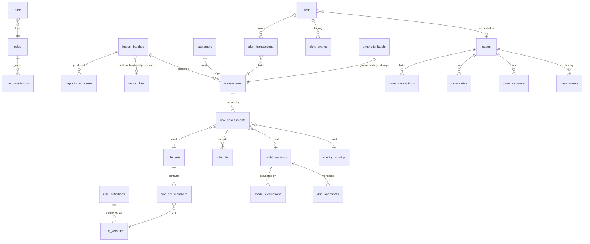

# Sentinel — Database Design

> Phase 1 design. PostgreSQL 16. All primary keys are UUIDv7-style (time-ordered) generated in the application. All timestamps are `timestamptz` (UTC). Money is `NUMERIC(18,2)`.

## 1. Entity-relationship overview

## 2. Tables

### Identity & access
| Table | Key columns | Notes |
|---|---|---|
| `users` | id, email (unique, citext), full_name, password_hash, role_id, is_active, failed_login_count, locked_until, version | Never stores plaintext secrets |
| `roles` | id, name (`admin`/`analyst`/`auditor`) | Seeded |
| `role_permissions` | role_id, permission | Composite PK |
| `user_permission_grants` | user_id, permission, granted_by | e.g. `alerts:assign_others` for lead analysts |
| `refresh_tokens` | id, user_id, token_hash, family_id, expires_at, revoked_at, replaced_by | Reuse of a rotated token revokes the whole family |

### Ingestion
| Table | Key columns | Notes |
|---|---|---|
| `import_batches` | id, source (`csv`/`api`), source_system, filename, file_sha256, file_size_bytes, status (`queued`/`processing`/`completed`/`rejected`/`failed`), row_count, accepted_count, rejected_count, duplicate_count, possible_duplicate_count, ignored_columns, file_error, identical_to_batch_id, job_id, uploaded_by_id, created_at, started_at, finished_at | `file_sha256` is indexed, not unique: re-uploading the same file is allowed (rows become duplicates) and the batch links to the earlier one via `identical_to_batch_id` |
| `import_files` | batch_id (PK), content (bytea) | Raw upload, deleted once processed. Lets the API and worker share the file without a shared volume |
| `import_row_issues` | id, batch_id, row_number, outcome (`rejected`/`duplicate`/`possible_duplicate`), external_id, transaction_id, reasons (jsonb: `[{field, code, message}]`), raw_row (jsonb, rejected rows only, redacted) | Powers the rejected-record report. Renamed from the Phase 1 `rejected_records` because possible duplicates are reported here too, although they are stored |
| `processing_jobs` | id, kind, payload jsonb, status (`queued`/`running`/`succeeded`/`dead`), attempts, max_attempts, run_after, locked_by, locked_at, last_error, created_at, finished_at | Claimed with `FOR UPDATE SKIP LOCKED`; retried with exponential backoff; jobs whose worker died are re-queued after the lock timeout |

### Transactions
| Table | Key columns | Notes |
|---|---|---|
| `customers` | id, external_ref (unique), created_at | Pseudonymous synthetic id; **no** name, DOB, gender, ethnicity, nationality, address. The generator's `segment` and `home_city` are deliberately not stored: segment is a generator artefact that would leak into features, and home city is derivable from history |
| `transactions` | id, external_id, source_system, customer_id, amount, currency, occurred_at, txn_type, merchant_category, channel, city, country, lat, lon, device_id_hash, status, batch_id, content_hash, ingested_at | Immutable after insert |

Constraints: `UNIQUE (source_system, external_id)`; `CHECK (amount > 0)`; enum checks on `currency`, `txn_type`, `channel`, `merchant_category`, `status` (a test asserts they match `sentinel.core.vocabulary`); lat/lon ranges and both-or-neither. `UPDATE`, `DELETE` and `TRUNCATE` are rejected by trigger.
`device_id_hash` stores a keyed hash (HMAC-SHA256 with `SENTINEL_HASH_SALT`) of the incoming device identifier — the system only needs equality comparisons. `content_hash` is a SHA-256 of all fields except `external_id`, used to flag possible duplicates.
The full field list and validation rules are in [DATA_DICTIONARY.md](DATA_DICTIONARY.md).

### Detection configuration (versioned, never edited in place — Phase 4)
| Table | Key columns | Notes |
|---|---|---|
| `rule_definitions` | id, code (unique, e.g. `VELOCITY_1H`), name, description, category | The rule's identity; seeded from the code catalogue (a test checks they match) |
| `rule_versions` | id, rule_id, version, params jsonb (validated by the rule's Pydantic schema), weight, severity, force_alert, is_active, change_reason, created_by_id, created_at | Admin edit → new row. **Append-only** |
| `rule_sets` | id, version, change_reason, created_by_id, created_at | Snapshot taken on every rule change. The latest version is the one used for scoring. **Append-only** |
| `rule_set_members` | rule_set_id, rule_version_id | Pins the current version of **every** rule (active or not), so a rule set fully describes the configuration. **Append-only** |
| `scoring_configs` | id, version, w_rule, w_model, rule_cap, bands jsonb, alert_threshold, is_active, change_reason, created_by_id | Only one active (partial unique index). v1 seeded in Phase 4; the admin API to change it comes with alerts in Phase 7 |

### Scoring (Phase 4, rules-only)
| Table | Key columns | Notes |
|---|---|---|
| `risk_assessments` | id, transaction_id, mode (`rules_only`/`combined`), rule_score, model_score, model_version_id (FK added in Phase 6), risk_score (0–100), risk_category, force_alert, scoring_config_id, rule_set_id, feature_set_version, features jsonb, reasons jsonb, job_id, assessed_at | **Append-only.** Re-scoring creates a new row; the latest is found via `(transaction_id, assessed_at)`. `features` is a snapshot of the exact values the rules saw |
| `rule_hits` | id, assessment_id, rule_version_id, rule_code, weight_applied, severity, force_alert, observed jsonb, threshold jsonb, explanation | One row per triggered rule — queryable ("which rule fires most?"). **Append-only** |

`processing_jobs.result` (jsonb) holds each job's summary (e.g. assessments by category, hits by rule); `import_batches.scoring_job_id` links an import to its scoring job.

### Alerts
| Table | Key columns | Notes |
|---|---|---|
| `alerts` | id, reference (`ALR-000123`, from sequence `alert_reference_seq`), customer_id, primary_assessment_id, severity, priority_score, status, assignee_id, case_id (FK in Phase 8), resolution_reason, transaction_count, last_activity_at, opened_at, closed_at, updated_at, version | Phase 7. `version` for optimistic locking. CHECKs: terminal statuses (`closed`, `escalated`) ⇔ resolution and `closed_at` present; `assigned`/`in_review` require an assignee |
| `alert_transactions` | alert_id, transaction_id (**unique**), assessment_id, linked_at | **Append-only.** A transaction belongs to at most one alert. An open alert absorbs further alertable transactions of the same customer within 24 h of its latest activity |
| `alert_events` | id, alert_id, actor_id (null = system), event_type (`created`, `transaction_linked`, `claimed`, `assigned`, `review_started`, `closed`, `reopened`, `note`), from_status, to_status, payload jsonb, created_at | **Append-only**; notes are events, corrections are new notes referencing the original |

`risk_assessments.contributions` (jsonb, Phase 7) stores the top model feature contributions for explained assessments.

### Investigations
| Table | Key columns | Notes |
|---|---|---|
| `cases` | id, reference (`CASE-00042`), title, customer_id, status, priority, assignee_id, opened_by, escalated_to_id, outcome, outcome_summary, opened_at, closed_at, closed_by, version | `CHECK (status <> 'closed' OR outcome IS NOT NULL)`; four-eyes check in service: if escalated, `closed_by <> assignee_id` |
| `case_transactions` | case_id, transaction_id, added_by, added_at, reason | |
| `case_notes` | id, case_id, author_id, body, supersedes_note_id, created_at | No update/delete |
| `case_evidence` | id, case_id, kind (`transaction`/`document_ref`/`external_ref`/`screenshot_ref`), reference, description, added_by, created_at | References only — no file uploads of real documents |
| `case_events` | id, case_id, actor_id, event_type, payload jsonb, created_at | Append-only |

### Models & monitoring
| Table | Key columns | Notes |
|---|---|---|
| `model_versions` | id, name, version (unique), family (`logreg`/`random_forest`/`isolation_forest`/`rules_baseline`), artefact_path (relative to `SENTINEL_MODELS_DIR`), artefact_sha256, feature_schema_hash, feature_set_version, training_dataset_version, selected_by_experiment, manifest jsonb, status (`registered`/`active`/`retired`), registered_at, activated_by_id, activated_at | Phase 6. Partial unique index: one `active`. Rule baseline has no artefact (CHECK). `risk_assessments.model_version_id` now references it |
| `model_evaluations` | id, model_version_id, dataset_version, split (`validation`/`test`/`holdout`), threshold_kind (`budget`/`f1`), threshold, metrics jsonb (confusion counts, precision, recall, f1, pr_auc, roc_auc, fpr, alerts/FP per 1k, value detection, brier), ci95 jsonb, curves jsonb (PR, ROC, histograms, reliability), created_at | Phase 6. **Append-only.** Per-typology results stay in the experiment report |
| `drift_snapshots` | id, model_version_id, window_start, window_end, feature_psi jsonb, score_psi, prediction_count, alert_count, created_at | Computed daily/on demand by worker |
| `synthetic_labels` | transaction_id (PK), is_fraud_injected, typology, scenario_id | **Evaluation only.** No foreign key from scoring tables; not exposed through analyst endpoints |

### Audit
| Table | Key columns | Notes |
|---|---|---|
| `audit_log` | id (bigserial), occurred_at, actor_id, actor_role, action, entity_type, entity_id, before jsonb, after jsonb, request_id, ip_hash | Append-only via trigger |

## 3. Indexes (initial)

| Index | Serves |
|---|---|
| `transactions (customer_id, occurred_at DESC)` | Customer history window queries — the hottest path in feature building |
| `transactions (occurred_at DESC, id)` | Keyset pagination in the explorer |
| `transactions (batch_id)` | Import drill-down |
| `risk_assessments (transaction_id, assessed_at DESC)` | Latest assessment per transaction |
| `risk_assessments (assessed_at)` BRIN | Monitoring windows over a large append-only table |
| `rule_hits (rule_version_id)` | Rule effectiveness reports |
| `alerts (status, priority_score DESC, opened_at)` | Alert queue ordering |
| `alerts (assignee_id) WHERE status NOT IN ('closed')` | "My work" view (partial index) |
| `alert_events (alert_id, created_at)`, `case_events (case_id, created_at)` | Timelines |
| `audit_log (entity_type, entity_id, occurred_at)` | Entity history |

## 4. Integrity mechanisms

1. **Append-only enforcement** — trigger `forbid_modification()` raising an exception on `UPDATE`/`DELETE`/`TRUNCATE` for `audit_log`, `transactions`, `rule_versions`, `rule_sets`, `rule_set_members`, `alert_events`, `case_events`, `case_notes`, `risk_assessments`, `rule_hits`.
2. **Optimistic concurrency** — `alerts.version`, `cases.version`; `UPDATE … WHERE id = :id AND version = :v` → 0 rows ⇒ HTTP 409.
3. **Versioned configuration** — rules and scoring config are never updated in place, so any historical assessment can be fully reproduced from the versions it references.
4. **Label isolation** — `synthetic_labels` is read only by the evaluation/monitoring module; an architecture test asserts no scoring or alert code imports it.

## 5. Migrations

Alembic, one migration per logical change, autogenerate reviewed by hand. Triggers, partial indexes and check constraints are written explicitly in migrations. `alembic upgrade head` runs on container start in development; production-style deployment runs it as a separate step (documented in DEPLOYMENT.md, Phase 10).
