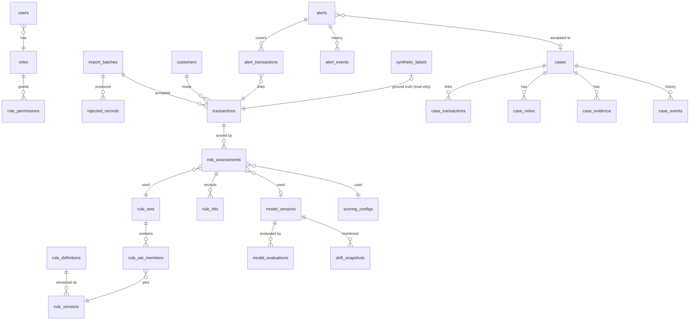

# Sentinel — Database Design

> Phase 1 design. PostgreSQL 16. All primary keys are UUIDv7-style (time-ordered) generated in the application. All timestamps are `timestamptz` (UTC). Money is `NUMERIC(18,2)`.

## 1. Entity-relationship overview

## 2. Tables

### Identity & access
| Table | Key columns | Notes |
|---|---|---|
| `users` | id, email (unique, citext), full_name, password_hash, role_id, is_active, failed_login_count, locked_until, version | Never stores plaintext secrets |
| `roles` | id, name (`admin`/`analyst`/`auditor`) | Seeded |
| `role_permissions` | role_id, permission | Composite PK |
| `user_permission_grants` | user_id, permission, granted_by | e.g. `alerts:assign_others` for lead analysts |
| `refresh_tokens` | id, user_id, token_hash, family_id, expires_at, revoked_at, replaced_by | Reuse of a rotated token revokes the whole family |

### Ingestion
| Table | Key columns | Notes |
|---|---|---|
| `import_batches` | id, source (`csv`/`api`), filename, file_sha256, uploaded_by, status, row_count, accepted_count, rejected_count, duplicate_count, started_at, finished_at | Unique on `file_sha256` warns re-upload of identical file |
| `rejected_records` | id, batch_id, row_number, raw_row (jsonb, sensitive fields redacted), errors (jsonb: `[{field, code, message}]`) | Powers rejected-record report |
| `processing_jobs` | id, kind, payload jsonb, status, attempts, run_after, locked_by, locked_at, last_error | Claimed with `FOR UPDATE SKIP LOCKED` |

### Transactions
| Table | Key columns | Notes |
|---|---|---|
| `customers` | id, external_ref (unique), segment, home_city, created_at | Pseudonymous synthetic id; **no** name, DOB, gender, ethnicity, nationality, address |
| `transactions` | id, external_id, source_system, customer_id, amount, currency, occurred_at, txn_type, merchant_category, channel, city, country, lat, lon, device_id_hash, status, batch_id, content_hash, ingested_at | Immutable after insert |

Constraints: `UNIQUE (source_system, external_id)`; `CHECK (amount > 0)`; enum checks on `currency`, `txn_type`, `channel`, `status`; `CHECK (lat BETWEEN -90 AND 90)`.
`device_id_hash` stores a salted SHA-256 of the incoming device identifier — the system only needs equality comparisons.

### Detection configuration (versioned, never edited in place)
| Table | Key columns | Notes |
|---|---|---|
| `rule_definitions` | id, code (unique, e.g. `VELOCITY_1H`), name, description, category | The rule's identity |
| `rule_versions` | id, rule_id, version, params jsonb (validated by per-rule Pydantic schema), weight, severity, force_alert, is_active, created_by, created_at, change_reason | Admin edit → new row |
| `rule_sets` | id, version, created_by, created_at | Snapshot of the active rule versions at a point in time |
| `rule_set_members` | rule_set_id, rule_version_id | |
| `scoring_configs` | id, version, w_rule, w_model, rule_cap, bands jsonb, alert_threshold, is_active, created_by, change_reason | Only one active (partial unique index) |

### Scoring
| Table | Key columns | Notes |
|---|---|---|
| `risk_assessments` | id, transaction_id, risk_score (0–100), risk_category, model_version_id (nullable), model_score, scoring_config_id, rule_set_id, reasons jsonb, contributions jsonb, assessed_at, job_id | **Append-only.** Re-scoring creates a new row; latest is found via index |
| `rule_hits` | assessment_id, rule_version_id, observed jsonb, threshold jsonb, weight_applied | One row per triggered rule — queryable ("which rule fires most?") |

### Alerts
| Table | Key columns | Notes |
|---|---|---|
| `alerts` | id, reference (`ALR-000123`), customer_id, primary_assessment_id, severity, priority_score, status, assignee_id, case_id, resolution_reason, opened_at, closed_at, version | `version` for optimistic locking |
| `alert_transactions` | alert_id, transaction_id, assessment_id | An open alert absorbs further hits for the same customer within 24h |
| `alert_events` | id, alert_id, actor_id, event_type, from_status, to_status, payload jsonb, created_at | Append-only; includes notes |

### Investigations
| Table | Key columns | Notes |
|---|---|---|
| `cases` | id, reference (`CASE-00042`), title, customer_id, status, priority, assignee_id, opened_by, escalated_to_id, outcome, outcome_summary, opened_at, closed_at, closed_by, version | `CHECK (status <> 'closed' OR outcome IS NOT NULL)`; four-eyes check in service: if escalated, `closed_by <> assignee_id` |
| `case_transactions` | case_id, transaction_id, added_by, added_at, reason | |
| `case_notes` | id, case_id, author_id, body, supersedes_note_id, created_at | No update/delete |
| `case_evidence` | id, case_id, kind (`transaction`/`document_ref`/`external_ref`/`screenshot_ref`), reference, description, added_by, created_at | References only — no file uploads of real documents |
| `case_events` | id, case_id, actor_id, event_type, payload jsonb, created_at | Append-only |

### Models & monitoring
| Table | Key columns | Notes |
|---|---|---|
| `model_versions` | id, name, version, family (`logreg`/`random_forest`/`isolation_forest`/`rules_baseline`), artefact_path, artefact_sha256, feature_schema_hash, training_dataset_version, status (`registered`/`active`/`retired`), registered_at, activated_by, activated_at | Partial unique index: one `active` |
| `model_evaluations` | id, model_version_id, dataset_version, split, metrics jsonb (precision, recall, f1, pr_auc, roc_auc, fpr, brier…), confusion jsonb, curves jsonb (downsampled PR/ROC points), threshold, per_typology jsonb, created_at | Assessment history for auditors |
| `drift_snapshots` | id, model_version_id, window_start, window_end, feature_psi jsonb, score_psi, prediction_count, alert_count, created_at | Computed daily/on demand by worker |
| `synthetic_labels` | transaction_id (PK), is_fraud_injected, typology, scenario_id | **Evaluation only.** No foreign key from scoring tables; not exposed through analyst endpoints |

### Audit
| Table | Key columns | Notes |
|---|---|---|
| `audit_log` | id (bigserial), occurred_at, actor_id, actor_role, action, entity_type, entity_id, before jsonb, after jsonb, request_id, ip_hash | Append-only via trigger |

## 3. Indexes (initial)

| Index | Serves |
|---|---|
| `transactions (customer_id, occurred_at DESC)` | Customer history window queries — the hottest path in feature building |
| `transactions (occurred_at DESC, id)` | Keyset pagination in the explorer |
| `transactions (batch_id)` | Import drill-down |
| `risk_assessments (transaction_id, assessed_at DESC)` | Latest assessment per transaction |
| `risk_assessments (assessed_at)` BRIN | Monitoring windows over a large append-only table |
| `rule_hits (rule_version_id)` | Rule effectiveness reports |
| `alerts (status, priority_score DESC, opened_at)` | Alert queue ordering |
| `alerts (assignee_id) WHERE status NOT IN ('closed')` | "My work" view (partial index) |
| `alert_events (alert_id, created_at)`, `case_events (case_id, created_at)` | Timelines |
| `audit_log (entity_type, entity_id, occurred_at)` | Entity history |

## 4. Integrity mechanisms

1. **Append-only enforcement** — trigger `forbid_modification()` raising an exception on `UPDATE`/`DELETE` for `audit_log`, `alert_events`, `case_events`, `case_notes`, `risk_assessments`, `rule_hits`.
2. **Optimistic concurrency** — `alerts.version`, `cases.version`; `UPDATE … WHERE id = :id AND version = :v` → 0 rows ⇒ HTTP 409.
3. **Versioned configuration** — rules and scoring config are never updated in place, so any historical assessment can be fully reproduced from the versions it references.
4. **Label isolation** — `synthetic_labels` is read only by the evaluation/monitoring module; an architecture test asserts no scoring or alert code imports it.

## 5. Migrations

Alembic, one migration per logical change, autogenerate reviewed by hand. Triggers, partial indexes and check constraints are written explicitly in migrations. `alembic upgrade head` runs on container start in development; production-style deployment runs it as a separate step (documented in DEPLOYMENT.md, Phase 10).
